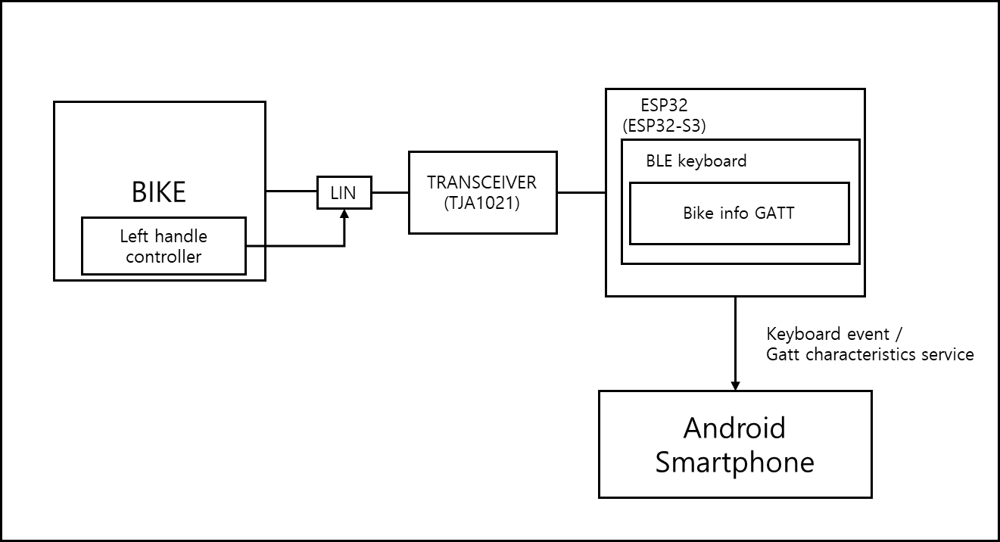
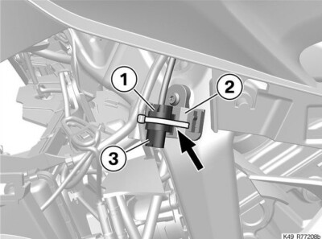
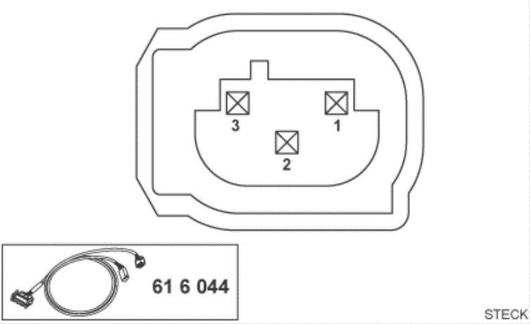
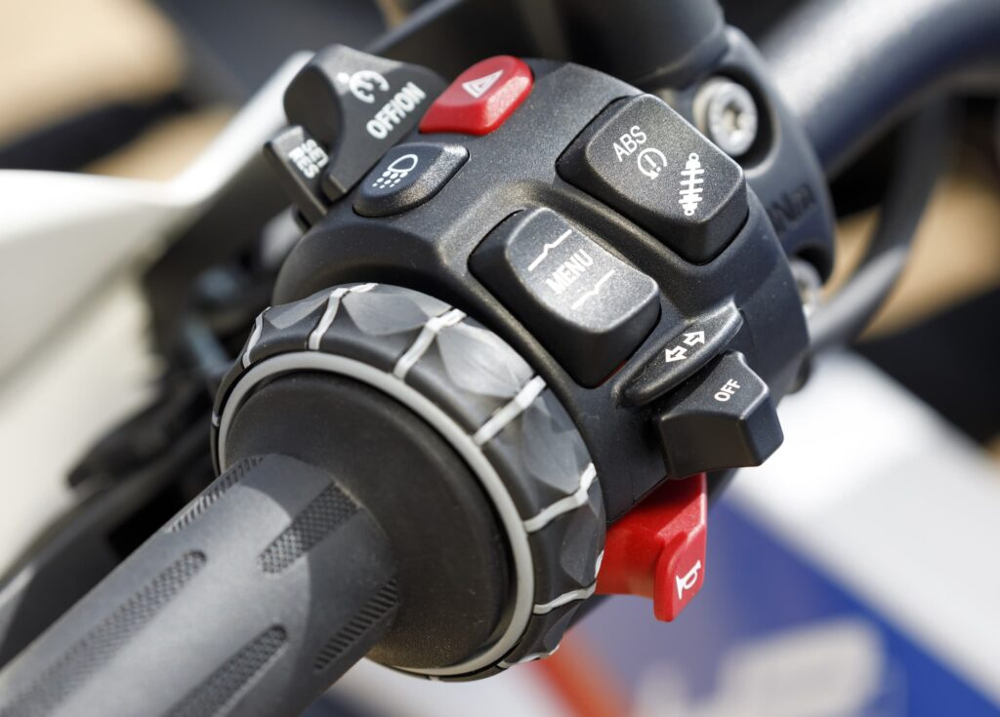

# BMW Motorrad Cluster — LIN Bus

[English](README.md)

BMW Motorrad 바이크의 LIN 버스 신호를 수집·분석하고, 안드로이드 클러스터 앱으로 전달합니다. Wonder Wheel / 좌측 핸들 컨트롤러 입력은 Bluetooth 키보드 신호로 변환해 클러스터용 스마트폰으로 보냅니다.

이 저장소는 **신호 분석·문서 허브**입니다. 펌웨어와 안드로이드 앱은 아래 관련 저장소에 있습니다.

| 저장소 | 역할 |
|---|---|
| **이 저장소** (`bmw-motorrad-cluster-linbus`) | LIN 프레임 분석, 커넥터 문서, 디코딩 필드 |
| [bmw-motorrad-cluster-esp32](https://github.com/kendrickkim/bmw-motorrad-cluster-esp32) | ESP32 펌웨어 (LIN 스니프 → BLE / BT HID) |
| [bmw-motorrad-cluster-application](https://github.com/kendrickkim/bmw-motorrad-cluster-application) | Android Compose 클러스터 UI |

## 목표

1. 바이크에서 발생하는 LIN 신호 수집
2. 수집 데이터 분석·문서화
3. 분석 결과를 안드로이드 클러스터 앱으로 전달
4. Wonder Wheel·좌측 핸들 컨트롤러 신호를 키보드 입력으로 매핑
5. Bluetooth로 클러스터/헤드유닛용 스마트폰에 전달

## 데모

<p align="center">
  <a href="https://www.youtube.com/watch?v=BmVxNDDYLkI">
    
  </a>
</p>

[YouTube에서 보기](https://www.youtube.com/watch?v=BmVxNDDYLkI)

## 구조

```text
BMW Motorrad (LIN)
        │
        ▼
 LIN 트랜시버 (예: TJA1021) + ESP32 / ESP32-S3
        │
        ▼
 Bluetooth (BLE / Wonder Wheel·컨트롤용 HID 키보드)
        │
        ▼
 안드로이드 폰 (클러스터 앱) + Android Auto 리시버 (예: Headunit Reloaded)
```



## 준비물

### 바이크

- 호환 BMW Motorrad 모델. [Chigee BMW Quick Release 호환 목록](https://support.chigee.com/portal/en/kb/articles/bmw-quick-release-module-compatible-with-my-bmw#Check_the_compatibility)을 참고하세요.
- **SA272** 옵션이 활성화되어 있어야 합니다. 목록에 있어도 SA272가 없으면 딜러에게 활성화를 요청하세요. (한국에서는 무료 활성화 사례가 있습니다 — 대구모토라드에서 확인)
- SA272 / ConnectedRide Cradle 배경: [BMW Group Press](https://www.press.bmwgroup.com/global/article/detail/T0359072EN/bmw-motorrad-presents-the-connectedride-cradle?language=en)

문서의 분석 기준은 별도 표기가 없으면 **BMW S1000XR (2016)** 입니다. 다른 모델 분석 기여를 환영합니다.

### 하드웨어·소프트웨어

| 항목 | 설명 |
|---|---|
| 안드로이드 스마트폰 | [클러스터 앱](https://github.com/kendrickkim/bmw-motorrad-cluster-application) 빌드·설치 |
| ESP32 보드 | ESP32 / ESP32-S3에서 동작 확인 (Arduino 플랫폼) |
| LIN 트랜시버 | TJA1021 칩 모듈 권장 (알리익스프레스 등) |
| Android Auto 리시버 | 이 프로젝트에서는 Headunit Reloaded 사용 |

### 필요한 스킬 (풀스택 구현 시)

- Android (Jetpack Compose)
- 하드웨어 / 디지털 신호 분석
- ESP32 (Arduino), BLE / HID 개념

## 물리적 연결 (S1000XR)

S1000XR은 왼쪽 페어링을 분리하면 네비게이션/크래들 소켓을 찾을 수 있습니다.



커넥터 핀맵:



| 핀 | 기능 | 설명 |
|---|---|---|
| 1 | GND | 접지 |
| 2 | LIN | 버스 신호 |
| 3 | 12V | 바이크 ON 시 공급 |

해당 소켓은 온라인 마켓에서 구할 수 있습니다.

## LIN을 디코딩하면?

BMW Motorrad는 CAN·LIN으로 차량 정보를 전달합니다. LIN은 CAN보다 저속·저비용이라 신호 수는 적지만 수집이 간단합니다.

디코딩한 데이터로 스마트폰 클러스터(속도, RPM, 기어, 전압 등)를 구동할 수 있고, **Wonder Wheel**과 좌측 핸들 컨트롤로 폰을 조작할 수 있습니다. 네비게이션/헤드유닛으로 폰을 쓸 때 특히 유용합니다.



## 분석된 신호 (2025-06-19 기준)

| 확보됨 | 추가 분석 필요 / 요청 |
|---|---|
| 속도 | 엔진 경보 |
| RPM | 방향 지시등 동작 |
| Wonder Wheel | 냉각수 온도 *(분석 노트에 일부 기록)* |
| 좌측 핸들 컨트롤러 | 적산거리 *(분석 노트에 기록 — 다른 차종 검증 필요)* |
| 기어 | 잔여 연료량 |
| 배터리 전압 | 등화류 점화 상태 |
| | 브레이크 압력(앞/뒤) |

바이트·비트 레이아웃은 [`lin_analysis/LIN_ANALYSIS-kr.md`](lin_analysis/LIN_ANALYSIS-kr.md) ([English](lin_analysis/LIN_ANALYSIS.md))를 참고하세요.

## 저장소 구성

```text
bmw-motorrad-cluster-linbus/
├── README.md                 # 영문
├── README-kr.md              # 한국어 (이 파일)
├── images/                   # 커넥터·구조·사진
└── lin_analysis/
    ├── LIN_ANALYSIS.md       # Message ID 디코드 표 (영문)
    └── LIN_ANALYSIS-kr.md    # 한국어
```
## 관련 프로젝트

- 클러스터 앱: [bmw-motorrad-cluster-application](https://github.com/kendrickkim/bmw-motorrad-cluster-application)
- ESP32 펌웨어: [bmw-motorrad-cluster-esp32](https://github.com/kendrickkim/bmw-motorrad-cluster-esp32)

## 기여

바이크를 타는 엔지니어의 디코드 표 확장, 다른 연식 검증, 펌웨어/앱 연동 개선을 환영합니다. 캡처 로그, 모델/연식, 필드 해석을 이슈나 PR로 남겨 주세요.
